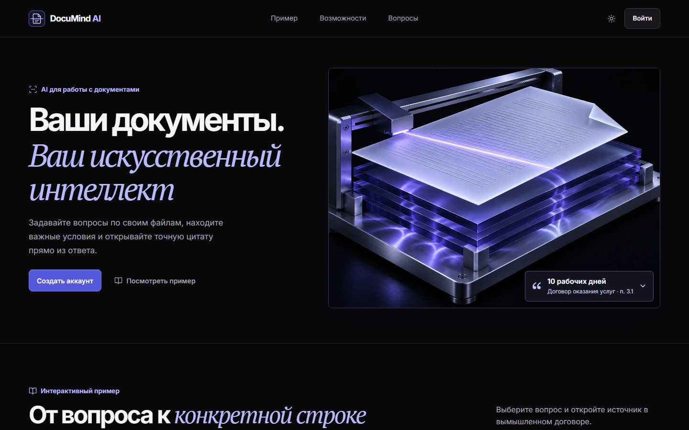
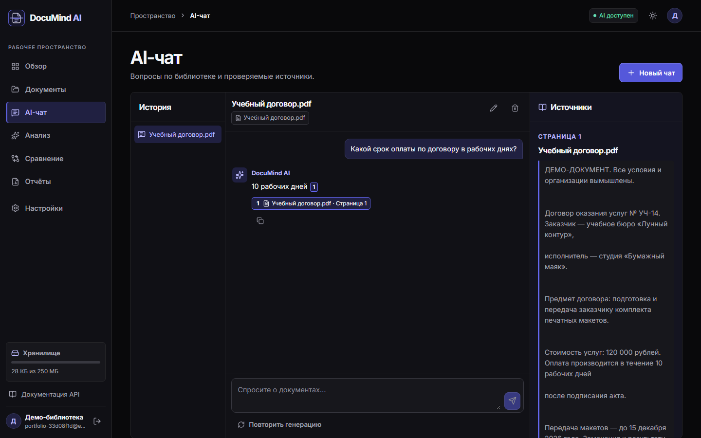
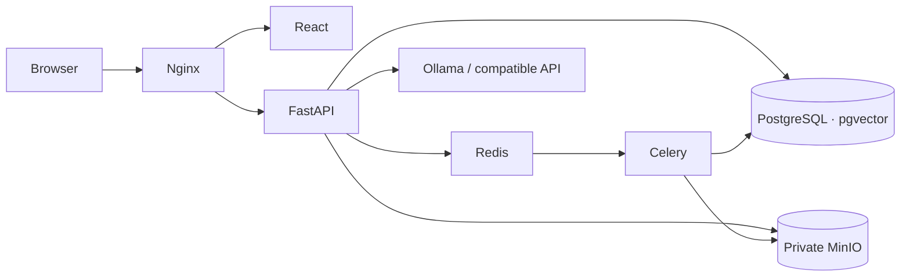

# DocuMind AI

A Russian-language workspace for private documents, vector search, and
AI answers with inspectable citations. Built as a full-stack portfolio project.

[Русская версия](README.ru.md) · [Architecture](docs/ARCHITECTURE.md) · [REST API](docs/API.md) · [Visual design](docs/DESIGN.md)



## What you can do

- Upload PDF, DOCX, TXT, Markdown, CSV and XLSX files. Local Russian and
  English OCR makes scanned PDF pages searchable and citable by page.
  Follow indexing status, preview PDFs, inspect extracted text and tag your files.
- Ask a question across selected documents. Follow the streaming response
  and open an actual excerpt using its citation.
- Analyze contracts, extract key terms, compare versions and download PDF,
  DOCX or Markdown reports.
- Review document activity, manage sessions and switch themes.



[Watch the upload-to-citation workflow](docs/screenshots/workflow.gif) ·
[Dashboard](docs/screenshots/dashboard.png) ·
[Scanned PDF and OCR result](docs/screenshots/ocr.png) ·
[Mobile](docs/screenshots/mobile.png)

## Start locally

```powershell
./scripts/init-env.ps1
docker compose up --build -d --wait
```

On Linux use `sh scripts/init-env.sh` for the first command.
Visit [localhost:8080](http://localhost:8080/) and register.
The first build compiles MinIO Community Edition and installs CPU
PyTorch and Tesseract. E5 model weights are downloaded on first use.

To enable AI, follow the [Ollama or OpenAI-compatible setup](docs/AI_PROVIDERS.md).
The local installation can be tested with `node scripts/smoke-live.mjs`.
The optional read-only demo account is populated with fictional contracts,
a proposal, a budget and a handbook.

```sh
docker compose exec backend python -m app.demo --email demo@example.com
```

## Stack

React 19, TypeScript, Vite, Tailwind, Radix and TanStack Query on the frontend.
FastAPI, SQLAlchemy Async, PostgreSQL 16 / pgvector, Redis / Celery, MinIO and
Sentence Transformers on the backend. Docker Compose orchestrates the stack.



## Verify

```sh
docker compose -p documind-ai-test -f compose.yaml -f compose.test.yaml up --build -d --wait
docker compose -p documind-ai-test -f compose.yaml -f compose.test.yaml --profile tests run --rm backend-tests
docker compose -p documind-ai-test -f compose.yaml -f compose.test.yaml exec backend alembic check
cd frontend
npm ci
npm run lint
npm test
npm run build
npx playwright install chromium
npm run e2e
```

The test stack uses port 8081, an isolated database and bucket, and a
deterministic test provider. The test profile never uses a paid AI endpoint.
The OCR tests use a fictional image-only PDF. For the same scan with a
live provider, run the smoke script with `DOCUMIND_SMOKE_OCR=1`.

## Limits and roadmap

Defaults are 25 MB per file, 20 documents, 250 MB storage, three queued or
processing documents, and 50 AI operations per day per account. OCR targets
printed text on PDF pages without a text layer and defaults to 30 scanned
pages per document. Recognition depends on scan quality. Comparison uses
extracted text, so layout-only changes are invisible. Model quality and
latency depend on the installation. Candidates for later work include
hybrid retrieval and more isolated worker resource limits.

[Deployment](docs/DEPLOYMENT.md) · [Security](docs/SECURITY.md) · [RAG implementation](docs/RAG.md) · [MIT license](LICENSE)
