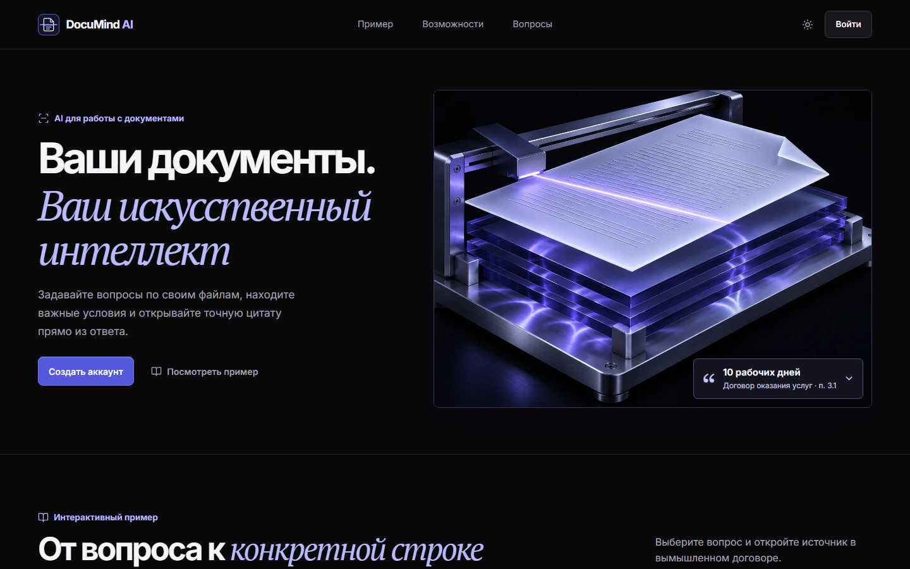
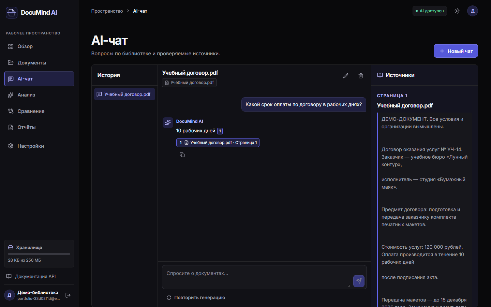
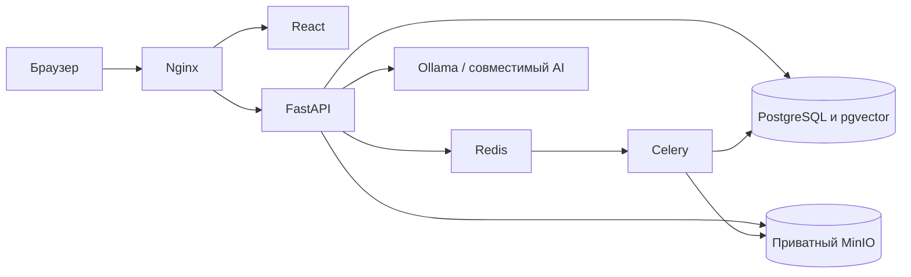

# DocuMind AI

Портфельное полнофункциональное веб-приложение для работы с приватными
документами, семантического поиска и AI-ответов с проверяемыми источниками.

[English](README.md) · [Архитектура](docs/ARCHITECTURE.md) · [REST API](docs/API.md) · [Дизайн](docs/DESIGN.md)



## Возможности

- Загружайте PDF, DOCX, TXT, Markdown, CSV и XLSX. Следите за обработкой,
  размечайте библиотеку категориями и тегами, открывайте PDF и извлечённый текст.
- Русский и английский печатный текст на сканах PDF распознаётся локально.
  По этому тексту можно искать в чате и переходить к конкретной странице.
- Спрашивайте по одному или нескольким документам. Ответ появляется
  постепенно, а ссылка в тексте открывает конкретный фрагмент источника.
- Выделяйте условия договора, сопоставляйте версии и скачивайте отчёты
  в PDF, DOCX и Markdown. В кабинете доступны активность, сессии и две темы.



[Сценарий от загрузки до источника](docs/screenshots/workflow.gif) ·
[Обзор](docs/screenshots/dashboard.png) · [Пример OCR](docs/screenshots/ocr.png) ·
[Мобильная версия](docs/screenshots/mobile.png)

## Запуск

На Windows с Docker Desktop

```powershell
./scripts/init-env.ps1
docker compose up --build -d --wait
```

На Linux используйте `sh scripts/init-env.sh` для первого шага.
Откройте [localhost:8080](http://localhost:8080/) и зарегистрируйтесь.
Первый запуск собирает MinIO из исходников и устанавливает CPU-зависимости
и Tesseract. Веса E5 загрузятся при первом обращении к модели.

[Настройка Ollama и облачного провайдера](docs/AI_PROVIDERS.md) ·
[Переменные окружения и развёртывание](docs/DEPLOYMENT.md)

Опциональная команда демо-данных создаёт аккаунт для чтения и вымышленные
договоры, предложение, бюджет и инструкцию. Пароль задаётся интерактивно.

```sh
docker compose exec backend python -m app.demo --email demo@example.com
```

## Технологии и схема

React, TypeScript, Vite, Tailwind, Radix, TanStack Query и Recharts.
Python 3.12, FastAPI, SQLAlchemy Async, Alembic, PostgreSQL 16,
pgvector, Redis, Celery, MinIO и Sentence Transformers.



## Тесты

```sh
docker compose -p documind-ai-test -f compose.yaml -f compose.test.yaml up --build -d --wait
docker compose -p documind-ai-test -f compose.yaml -f compose.test.yaml --profile tests run --rm backend-tests
cd frontend
npm ci
npm run typecheck
npm test
npx playwright install chromium
npm run e2e
```

Тестовый стек поднимается на 8081 и использует отдельные БД и bucket.
Для проверки реального провайдера на основном стеке запустите
`node scripts/smoke-live.mjs` из корня. С переменной `DOCUMIND_SMOKE_OCR=1`
скрипт загружает вымышленный скан без текстового слоя.

Лимиты по умолчанию составляют 25 МБ на файл, 20 файлов и 250 МБ на
аккаунт, до трёх документов в обработке и до 50 AI-запросов в сутки.
OCR по умолчанию обрабатывает до 30 сканированных страниц в одном PDF.
Точность зависит от качества скана. Для смешанных PDF сначала используется
текстовый слой каждой страницы. Сравнение учитывает извлечённый текст.
Гибридный поиск остаётся в планах.

[Безопасность](docs/SECURITY.md) · [Реализация RAG](docs/RAG.md) ·
[Оценка проекта](docs/REVIEW.md) · [Лицензия MIT](LICENSE)
