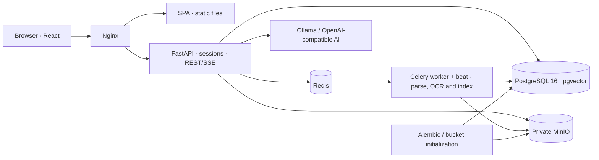

# Architecture

- **Request boundary.** Public access reaches the Nginx listener only. The SPA
  and API share an origin. Status and readiness are distinct endpoints.
- **Persistence.** A relational owner ID scopes private resources. File
  class and size limits, frozen initial migration and transactional cascades
  are enforced server-side. Tags are bounded values on each document because
  cross-document tag editing is outside the portfolio scope.
- **Queue.** PostgreSQL holds document state and a run ID. A short transaction
  claims each job. The worker parses and indexes outside the transaction,
  then checks the run ID before replacing the document's index atomically.
  A local Tesseract process handles raster PDF pages that lack native text.
  Transient failures are retried with delay. Beat reconciles missed messages
  and stale claims. A storage deletion outbox retries MinIO cleanup after a
  committed database deletion. Uploads create a delayed cleanup intent before
  writing the original, then remove the intent when the document commits.
- **AI.** Embeddings run locally in both retrieval and indexing. The LLM
  receives authorized excerpts for chat. The analysis route sends all
  document chunks in batches and reduces batch results. The comparison first
  computes a deterministic line diff, which can optionally be summarized by AI.
- **Reports.** The database stores report metadata. Report bytes are rendered
  on authenticated download. Removing a document cascades to analyses and
  comparisons, their report metadata and related chat history.
- **Frontend.** React Router handles deep links. TanStack Query manages server
  state, Radix Dialog manages focus, and the browser streams SSE through fetch.
  The access token stays in memory. Theme preference uses local storage.

See [RAG](RAG.md), [Security](SECURITY.md), and [REST API](API.md).
